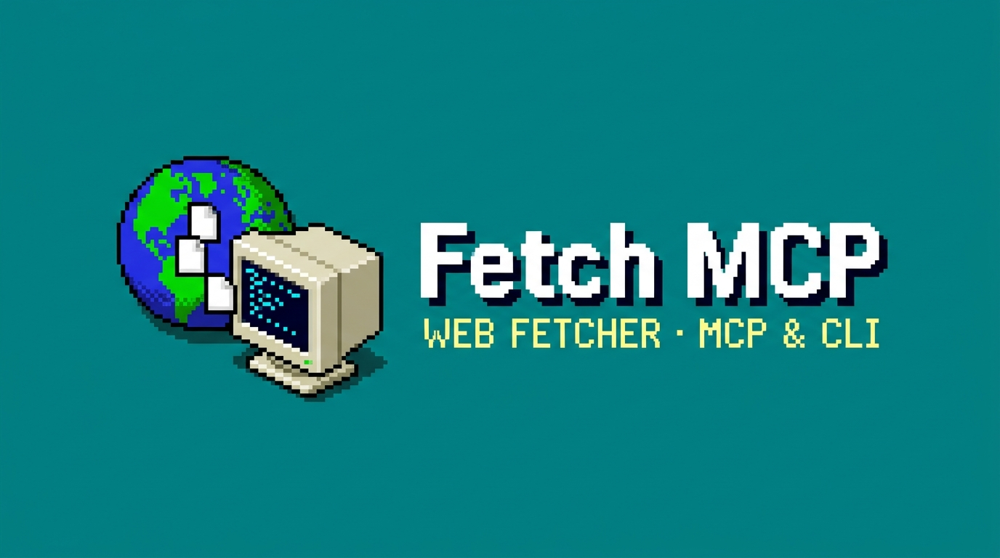

# Fetch MCP Server



[](https://www.npmjs.com/package/mcp-fetch-server)
[](https://fetch.zach.dev)

**Safely fetch any web content without opening your network.** A lightweight, SSRF-hardened MCP server (`mcp-fetch-server`, supporting both `stdio` and `2025-11-25` Streamable HTTP) and local CLI (`mcp-fetch`) for fetching public web content as HTML, Markdown, readable article Markdown, plain text, JSON, or YouTube transcripts. Supports Node.js `>= 22` LTS and Bun.

**Docs:** [fetch.zach.dev](https://fetch.zach.dev) · **LLM-friendly docs:** [fetch.zach.dev/llms.txt](https://fetch.zach.dev/llms.txt)

<a href="https://glama.ai/mcp/servers/nu09wf23ao">
  
</a>

## What's New & Breaking Changes in v2.0.0

### Highlights
- **MCP `2025-11-25` Streamable HTTP transport:** run `mcp-fetch-server --http [--host 127.0.0.1] [--port 3000]` to serve stateless MCP on `POST /mcp` with `Host`/`Origin` DNS-rebinding guards.
- **Cross-vendor MCP conformance:** all tool schemas include MCP `2025-11-25` read-only annotations, `additionalProperties: false`, and typed `headers` for clean compatibility across Claude, Gemini, and OpenAI MCP clients.
- **Expanded proxy support:** zero-dependency `http`, `https`, `socks4`, `socks4a`, `socks5`, `socks5h`, and bare `host:port` proxies with `NO_PROXY` support (including `:port` and `[ipv6]:port`) and mandatory credential redaction.

### Breaking Changes
- **Aligned MCP tool names:** `fetch_txt` → `fetch_text`, `fetch_youtube_transcript` → `fetch_transcript`.
- **Aligned CLI subcommands:** `txt` → `text`, `youtube` → `transcript`, plus repeatable `--header <Key:Value>`. `--lang` is now accepted only on `transcript` and rejected on web subcommands.
- **Strict MCP argument validation:** unexpected tool parameters (including any caller-supplied `proxy` key) are now rejected with `isError: true` instead of being silently ignored.
- **Fail-fast configuration:** invalid `DEFAULT_LIMIT`, `MAX_RESPONSE_BYTES`, or proxy URLs now fail explicitly instead of silently falling back to defaults or direct connections.
- **Explicit missing caption language:** requesting an unavailable YouTube transcript language now fails explicitly and lists the available language codes.
- **Runtime floor:** requires Node.js `>= 22` LTS or Bun.

## MCP Tools

All six tools conform to MCP `2025-11-25`, carry read-only annotations (`readOnlyHint: true`, `destructiveHint: false`, `idempotentHint: true`, `openWorldHint: true`), enforce strict `additionalProperties: false`, and accept the following common parameters (proxy routing for MCP is strictly Operator-configured via environment variables and can never be supplied by a tool caller):

| Parameter | Type | Required | Description |
|-----------|------|----------|-------------|
| `url` | string | Yes | Public `http:` or `https:` URL to fetch |
| `headers` | `Record<string, string>` | No | Optional custom request headers |
| `max_length` | number | No | Maximum characters to return (default: `DEFAULT_LIMIT` / `5000`; `0` = unlimited) |
| `start_index` | number | No | Start content from this character index (default: `0`; returns `""` if at or past output length) |

- **`fetch_html`** — Fetch a URL and return its unmodified HTML content.
- **`fetch_markdown`** — Fetch a URL, strip `<script>` and `<style>`, and convert to Markdown.
- **`fetch_readable`** — Extract the main article content using [Mozilla Readability](https://github.com/mozilla/readability), convert to Markdown, and prepend `# <title>` when present.
- **`fetch_text`** — Fetch a URL, strip `<script>` and `<style>`, and return normalized plain text.
- **`fetch_json`** — Fetch a JSON resource, validate via `JSON.parse`, and return compact JSON.
- **`fetch_transcript`** — Fetch a YouTube video's captions (tries local `yt-dlp` first with manual and auto-generated subtitles enabled, falling back to direct watch-page + caption XML extraction). Returns a `[Transcript language: ...]` header followed by `[m:ss]` timestamped lines. Accepts an optional `lang` parameter (default: `"en"`), and lists available language codes if the requested language is unavailable.

## Installation

### As an MCP server (`stdio`)

Add to your MCP client configuration (Claude Code, Claude Desktop, Gemini CLI, etc.):

```json
{
  "mcpServers": {
    "fetch": {
      "command": "npx",
      "args": ["mcp-fetch-server"]
    }
  }
}
```

### As a Streamable HTTP MCP server

Start the server on localhost (defaults to `127.0.0.1:3000`):

```bash
npx mcp-fetch-server --http --host 127.0.0.1 --port 3000
```

| Flag | Default | Description |
|------|---------|-------------|
| `--http` | *(off — uses `stdio`)* | Enable stateless MCP `2025-11-25` Streamable HTTP transport on `POST /mcp` |
| `--host <addr>` | `127.0.0.1` | Bind address (requires `--http`) |
| `--port <n>` | `3000` | Listen port `1`–`65535` (requires `--http`) |

Requests to `/mcp` validate `Host` and `Origin` headers against the bound address (`403` on mismatch to block localhost DNS rebinding). Unknown paths (including legacy `/sse`) return `404`, and non-`POST` methods return `405`.

Connect any Streamable HTTP MCP client to `http://127.0.0.1:3000/mcp` — for example, with MCP Inspector:

```bash
npx @modelcontextprotocol/inspector --url http://127.0.0.1:3000/mcp
```

### As a CLI

```bash
npx mcp-fetch <command> <url> [flags]
```

Or install globally:

```bash
npm install -g mcp-fetch-server
mcp-fetch <command> <url> [flags]
```

## CLI Usage

```text
mcp-fetch <command> <url> [flags]
```

### Commands

| Command | Description |
|---------|-------------|
| `html` | Fetch a URL and return raw HTML |
| `markdown` | Fetch a URL and return Markdown |
| `readable` | Fetch a URL and return article content as Markdown (via Readability) |
| `text` | Fetch a URL and return plain text |
| `json` | Fetch a URL and return JSON |
| `transcript` | Fetch a YouTube video transcript |

### Flags

| Flag | Description |
|------|-------------|
| `--header <Key:Value>` | Custom request header (repeatable) |
| `--max-length <N>` | Maximum characters to return (`0` = unlimited) |
| `--start-index <N>` | Start from this character index |
| `--proxy <URL>` | Proxy URL (`http`, `https`, `socks4`, `socks4a`, `socks5`, `socks5h`, or bare `host:port`; bypasses `NO_PROXY`) |
| `--lang <code>` | Language code for YouTube transcripts (only valid with `transcript`; default: `en`) |
| `--help` | Show help message |
| `--version` | Show version |

### Examples

```bash
# Fetch a page as markdown
mcp-fetch markdown https://example.com

# Extract article content without boilerplate
mcp-fetch readable https://example.com/blog/post

# Get a YouTube transcript in English (quote URLs containing '?' in zsh)
mcp-fetch transcript 'https://www.youtube.com/watch?v=jNQXAC9IVRw' --lang en

# Fetch with custom headers and a length limit
mcp-fetch html https://example.com --header "Accept-Language: en-US" --max-length 10000

# Fetch through an HTTP or SOCKS5 proxy
mcp-fetch json https://api.example.com/data --proxy socks5://127.0.0.1:1080
```

## Environment Variables

`mcp-fetch-server` validates `DEFAULT_LIMIT` and `MAX_RESPONSE_BYTES` fail-fast at startup (writing the error to `stderr` and exiting `1` if invalid).

| Variable | Description |
|----------|-------------|
| `DEFAULT_LIMIT` | Default character limit for responses (default: `5000`; `0` = unlimited; fails explicitly if invalid) |
| `MAX_RESPONSE_BYTES` | Maximum raw and decompressed response body size in bytes (default: `10485760` / 10 MB; positive integer; fails explicitly if invalid) |
| `HTTPS_PROXY` / `https_proxy` | Proxy URL for `https://` requests (`http`, `https`, `socks4`, `socks4a`, `socks5`, `socks5h`, or bare `host:port`) |
| `HTTP_PROXY` / `http_proxy` | Proxy URL for `http://` requests (fallback for `https://`) |
| `ALL_PROXY` / `all_proxy` | Fallback proxy URL for HTTP/HTTPS requests |
| `NO_PROXY` / `no_proxy` | Comma-separated hostnames, `.domain` suffixes, `:port` entries, `[ipv6]:port`, or `*` bypassing Operator env proxies (non-empty `NO_PROXY` takes precedence over `no_proxy`) |

Example with custom limits and an Operator proxy:

```json
{
  "mcpServers": {
    "fetch": {
      "command": "npx",
      "args": ["mcp-fetch-server"],
      "env": {
        "DEFAULT_LIMIT": "50000",
        "HTTPS_PROXY": "socks5://127.0.0.1:1080"
      }
    }
  }
}
```

## Security & Reliability

- **SSRF Protection:** Restricts all requests and redirect hops to `http:`/`https:`, blocks `localhost`/`*.localhost` and all IANA-reserved IPv4/IPv6 ranges (including IPv4-mapped IPv6 and multicast), fails closed on malformed IPs or DNS failures, pins validated DNS records directly to sockets on direct connections to prevent DNS rebinding, and delegates public hostname DNS to the proxy when proxied.
- **MCP Transport & Trust Boundary:** MCP tool callers can never supply or override proxy routing (`additionalProperties: false` rejects unexpected parameters such as a smuggled `proxy` key before any network I/O); Streamable HTTP defaults to `127.0.0.1` and validates `Host` and `Origin` headers to block localhost DNS rebinding.
- **Header & Redirect Hygiene:** Strips `Authorization`, `Cookie`, and `Proxy-Authorization` across cross-origin redirects and cross-origin YouTube caption URLs, caps redirects at 10 hops, rejects CR/LF and invalid header characters, and redacts proxy credentials from all error and diagnostic output.
- **Resource Safety:** Enforces `MAX_RESPONSE_BYTES` across declared `Content-Length`, streaming wire bytes, decompressed `gzip`/`deflate`/`br` streams, and `yt-dlp` subtitle files; rejects clearly binary `Content-Type` responses; enforces a `30s` single-attempt timeout.
- **YouTube Isolation:** Restricts `fetch_transcript` / `mcp-fetch transcript` to allowlisted YouTube hosts, validates `lang` codes strictly, passes `--` end-of-options sentinel to `yt-dlp`, and never swallows validation or SSRF errors into fallback.

## Development

```bash
bun install
bun run lint                       # Biome lint & formatting check
bun run typecheck                  # TypeScript typecheck
bun run build                      # Build dist/index.js and dist/cli.js
bun test                           # Unit, integration, scenario, and offline replay matrix tests
bun run harness                    # Interactive DD harness (type help)
bun run harness run scenarios      # Replay all DD harness scenarios
bun run verify:replay              # Run 3-form-factor offline cassette replay (CLI, stdio, Streamable HTTP)
bun run verify:live                # On-demand live-internet verification across all 3 form factors (add -- --record to refresh cassettes)
```

## License

This project is licensed under the MIT License.
